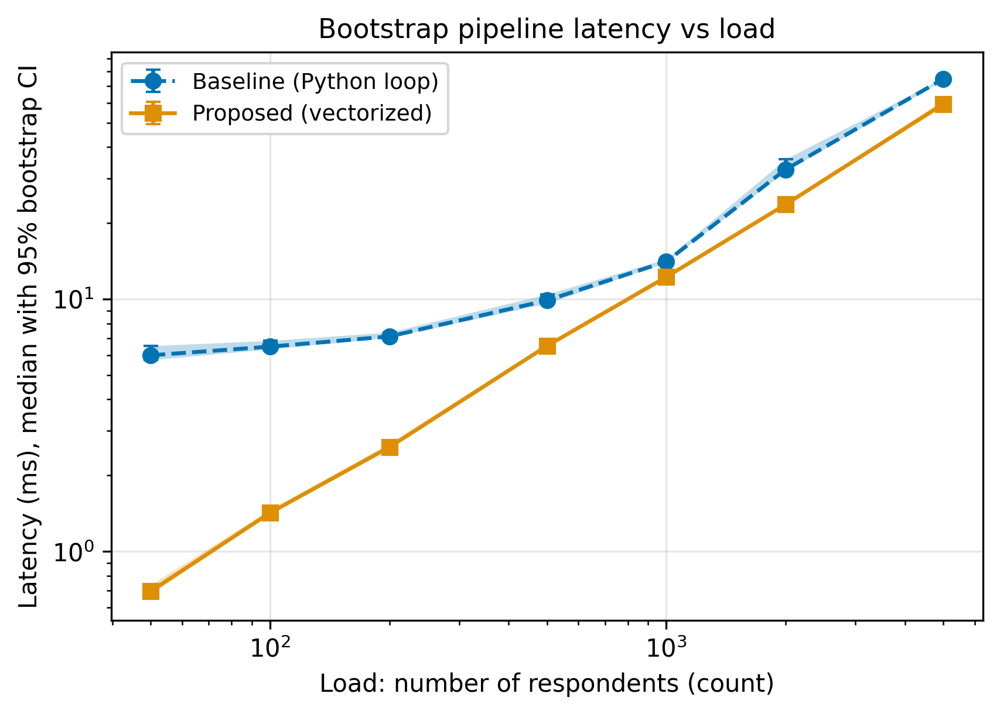
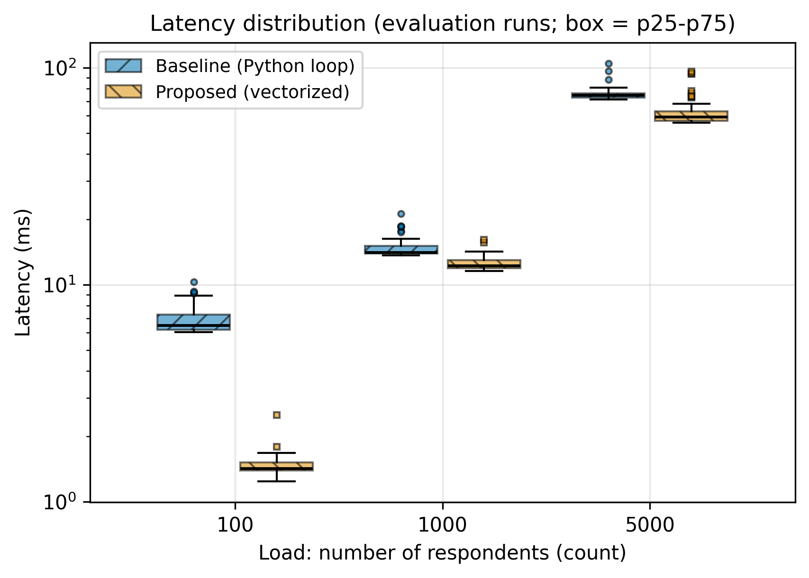

# Chatbot Personalization, 24/7 Availability and Repurchase Intention in Online Consumer Electronics

**Authors:** Kubantov Mukhamedzhan, Rakhimbek Baizhan  
**Course:** Research Methods (Task 2: Reproducible Research Repository)

## Overview

This repository accompanies a quantitative survey study on how AI chatbot personalization and perceived 24/7 availability affect customer satisfaction, brand trust and repurchase intention in online consumer electronics. It contains the methodology card, configuration, sample data and a reproducible analysis pipeline.

## System Requirements

- Docker (recommended), or Python 3.12 with the packages in `requirements.txt`
- Git
- About 500 MB of free disk space for the Docker image; no GPU needed

## Research Question

How do AI chatbot personalization and perceived 24/7 availability, individually and jointly, influence customer satisfaction, brand trust and repurchase intention in the online consumer electronics segment, and how is this moderated by tech-savviness and product price/complexity?

| ID | Hypothesis (alternative) | Dependent variable |
|----|--------------------------|--------------------|
| H1 | Chatbot personalization positively affects satisfaction | Satisfaction |
| H2 | Perceived 24/7 availability positively affects brand trust | Brand trust |
| H3a | Personalization x availability interaction positively affects repurchase intention | Repurchase intention |
| H3b | Tech-savviness and price/complexity moderate availability -> trust | Brand trust |

## Methodology Note

The full study uses a survey (Likert items) analysed with PLS-SEM. This repository contains a lightweight, fully reproducible pipeline: construct scores (mean of items), reliability check (Cronbach's alpha), and one OLS model per hypothesis with standardized betas, bootstrap confidence intervals, VIF and a controls-only baseline. The full PLS-SEM analysis is carried out on the collected survey data in the main study phase.

The file in `data/sample/` is **synthetic** (10 rows) and is meant only to verify that the code runs. Its results have no statistical meaning.

## Repository Structure

    .
    |-- configs/config.yaml     # all settings
    |-- data/
    |   |-- sample/             # synthetic 10-row sample (tracked)
    |   +-- raw/                # real survey data (git-ignored)
    |-- src/benchmark.py        # analysis pipeline
    |-- notebooks/              # exploratory notebooks
    |-- docs/                   # methodology card and notes
    |-- results/                # generated outputs (git-ignored)
    |-- Dockerfile
    |-- requirements.txt        # pinned dependencies
    +-- LICENSE                 # MIT

## Quickstart

**With Docker (recommended):**

```bash
docker build -t chatbot-repurchase .
docker run --rm -v "$(pwd)/results:/app/results" chatbot-repurchase
```

(PowerShell: replace `$(pwd)` with `${PWD}`.)

**Without Docker (Python 3.12):**

```bash
python -m venv .venv
source .venv/bin/activate        # Windows: .venv\Scripts\activate
pip install -r requirements.txt
python src/benchmark.py --config configs/config.yaml
```

Outputs are written to `results/`: `results.csv` (coefficients), `reliability.csv`, `summary.json` (including runtime and memory) and `run.log`.

## Benchmarks

Run on the synthetic sample (`seed: 42`, 2000 bootstrap resamples). Metrics: R-squared of the full model versus the controls-only baseline; the guardrail is the maximum VIF among predictors (threshold 5.0).

| Hypothesis | Key term | R2 (full) | R2 (baseline) | Max VIF |
|---|---|---|---|---|
| H1 | PERS | 0.991 | 0.890 | 7.06 |
| H2 | AVAIL | 0.984 | 0.836 | 4.01 |
| H3a | PERS:AVAIL | 1.0 | 0.858 | 21764.75 |
| H3b | AVAIL:TECH, AVAIL:COMPLEX | 0.994 | 0.836 | 151.38 |

Runtime: 1.214 s, peak Python memory: 0.47 MB (Python 3.12.15, N = 10 synthetic respondents).

Reliability guardrail: Cronbach's alpha >= 0.70 for every construct (see `results/reliability.csv`).

## Reproducibility

- Random seed fixed in `configs/config.yaml`.
- Dependency versions pinned in `requirements.txt`; base image `python:3.12-slim`.
- Every parameter is in the config file; no values are hard-coded in the script.

## Task 3: Performance Benchmark of the Bootstrap Pipeline

### Goal

Measure how the bootstrap step of the analysis pipeline (the core of Task 2) behaves under growing load, and compare a baseline implementation with a proposed vectorized one. The measurements describe the performance of the pipeline, not the results of the survey study. All data are synthetic.

### Methods compared

- **Baseline:** one least-squares fit per bootstrap resample inside a Python loop.
- **Proposed:** all resamples are solved in one vectorized batch (resample counts and two matrix products).

Both methods use the same seed and the same data. A formal description is in [docs/domain_model.md](docs/domain_model.md).

### Experimental protocol

- Load: 50, 100, 200, 500, 1000, 2000 and 5000 respondents (6 predictors, 200 bootstrap resamples per run).
- For every method and load: 5 warm-up runs (discarded in the analysis) and 50 evaluation runs.
- Latency is wall-clock time of one run in milliseconds; peak memory is measured in a separate pass so that memory tracing does not distort latency.
- A run counts as an error if it fails or returns non-finite values.
- Random seed: 42.

### Reproduce

```bash
python src/run_experiment.py --out data/raw/test_run.jsonl
python src/process_data.py
python src/visualize.py
```

### Data and outputs

| File | Content |
|---|---|
| `data/raw/test_run.jsonl` | Raw log, one JSON object per run, warm-up and evaluation phases |
| `data/processed/metrics_summary.csv` | Median, mean, SD, p25, p75, p95, p99, bootstrap 95% CI of the median, error rate, peak memory per method and load |
| `reports/figures/fig1_latency_vs_load.pdf` / `.png` | Median latency vs load with 95% CI |
| `reports/figures/fig2_distribution_boxplot.pdf` / `.png` | Latency distribution per method and load |
| `docs/data_contract.md` | Exact schema of the raw and processed files |

## Results & Discussion

All numbers below come from `notebooks/01_data_analysis.ipynb` and `data/processed/metrics_summary.csv`. The data are synthetic and were measured on one machine: 5 warm-up runs (discarded) and 50 evaluation runs per method and load, 200 bootstrap resamples per run, seed 42.

### Summary benchmark table (Baseline vs Proposed)

Latency is reported as the median with the interquartile range (p25-p75) in milliseconds; the speed-up is the baseline median divided by the proposed median. The full table with mean, SD, p99, 95% CI of the median, error rate and peak memory is in `data/processed/metrics_summary.csv`.

<<<PASTE THE TABLE HERE>>>

### Figures



*Figure 1. Median latency (ms) versus load (number of respondents) with 95% bootstrap confidence intervals, log-log axes.*



*Figure 2. Distribution of evaluation-run latency (ms) at 100, 1000 and 5000 respondents; boxes show p25-p75, whiskers 1.5 x IQR.*

### Discussion

The baseline fits the 200 bootstrap resamples one by one in a Python loop. The proposed method replaces the loop with two matrix products and one batched solve, which removes the per-resample Python overhead but builds a larger intermediate array. The key findings, computed in the notebook:

<<<PASTE THE 4 NUMBERED LINES HERE>>>

### Limitations

The data are synthetic and the measurements come from a single machine, so absolute times depend on the hardware. The benchmark describes the performance of the analysis pipeline, not the conclusions of the survey study.

### Domain model

The model, loss function and metrics are defined formally in [docs/domain_model.md](docs/domain_model.md).
## Citation

Kubantov, M., & Baizhan, R. (2026). *Chatbot personalization, 24/7 availability and repurchase intention in online consumer electronics* [Computer software]. GitHub. https://github.com/mukhamedzhankubantov/chatbot-repurchase-electronics

## License

MIT, see [LICENSE](LICENSE).